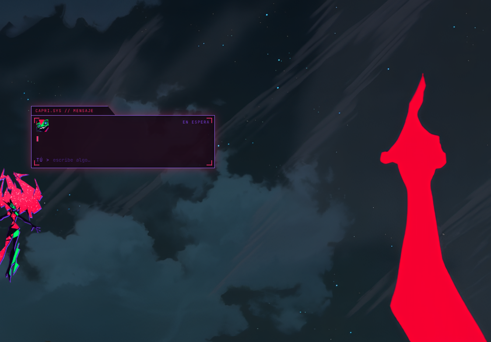
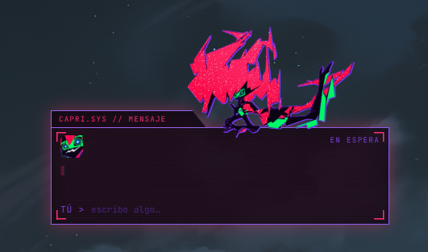
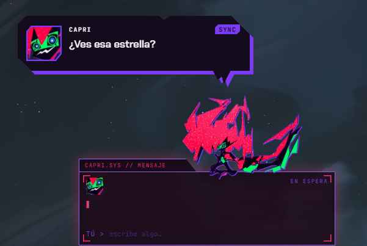
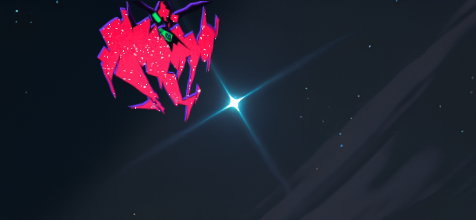
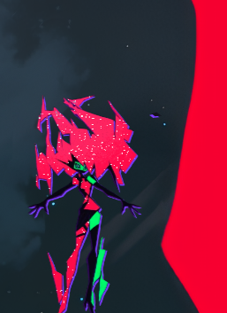
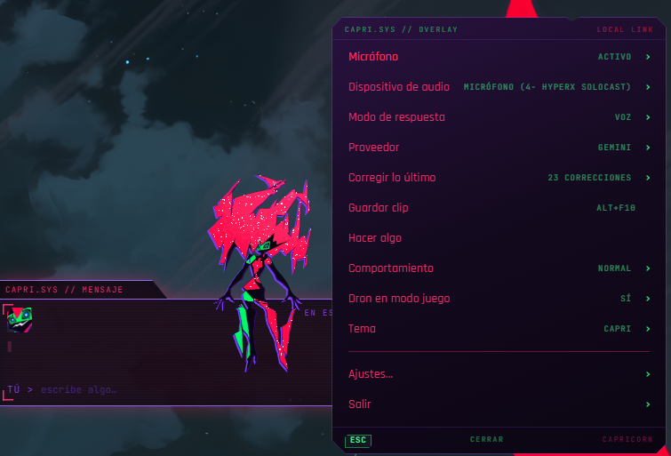
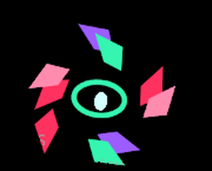

# Capri

Asistente de escritorio con el personaje **Capri** (*Cyberpunk: Edgerunners 2*): overlay siempre encima, chat por texto, beeps al escribir y un modelo local (LM Studio) o una clave en la nube.

**Capri es gratis y siempre lo será.** Nunca se vende. Las donaciones, si las hubiera, no bloquean nada.

> Fan art. No afiliado a CD PROJEKT RED. Arte y base de código: [mochiiwuff/capri-desktop](https://github.com/mochiiwuff/capri-desktop). Licencia PolyForm Noncommercial — [LICENSE](LICENSE), [CREDITS.md](CREDITS.md).

## Qué hace

- Overlay sin bordes, siempre encima, con widget compacto y burbuja estilo terminal
- Chat por texto (`YOU > …`) con personalidad cyberpunk (respuestas cortas, a veces sarcástica)
- Comentarios ocasionales, saludos al desbloquear Windows, reacciones al entorno
- Proveedores: **LM Studio** (local) o nube (**Gemini**, **OpenRouter**, Groq, OpenAI, Mistral, DeepSeek)
- Personalidad y memoria editables (`persona.md` / `memory.md` en tu carpeta de datos)
- Dron ligero mientras juegas a pantalla completa (modo juego)
- (Opcional, **no** va en el instalador público) sidecar de voz si lo montas tú en local

### Se encariña

- **Caricias** *(próximamente)*: reaccionar al cursor sobre la cabeza
- **Saludos**: al arrancar y, si quieres, al desbloquear la sesión de Windows
- **Comentarios**: de vez en cuando suelta una línea sobre lo que pasa en el PC
- **Si la ignoras**: se pliega al widget DORMANT tras un rato en silencio; vuelve cuando la despiertas o le escribes

## Instalar

### Inicio rápido (Windows, sin programar)

1. Baja `Capri-Setup-0.1.0.exe` desde [Releases](https://github.com/MtGhozt/Capri-Desktop/releases).
2. Si SmartScreen dice *Windows protegió tu PC*: **Más información → Ejecutar de todas formas**. El instalador no está firmado con certificado de pago; es normal en un proyecto gratis.
3. Completa el instalador y abre **Capri**. No hace falta Node.js ni admin.

Menú: **clic derecho** sobre ella (también en el icono de la bandeja; Windows 11 a menudo lo esconde detrás de **^**).

## Sonidos

En esta versión pública responde con **blips** (beeps al escribir en la burbuja). No hay voz hablada (TTS) de fábrica: el clon y los modelos de voz **no** viajan en el instalador. Quien monte el sidecar en local puede elegir **VOZ** en el menú.

## ¿Es seguro?

- El código está en este repo; el instalador se genera con `pnpm dist`.
- Las claves API se guardan cifradas con la cuenta de Windows (`safeStorage`), no en texto plano en git.
- Solo habla con servicios que **tú** eliges (LM Studio en `127.0.0.1`, o el proveedor cloud de Ajustes).
- SmartScreen avisa porque el `.exe` no está firmado, no porque haga algo oculto.
- Se desinstala como cualquier app (Configuración de Windows → Aplicaciones).

## Si Capri se traba

Si el overlay se congela, no responde al clic o no puedes cerrarla:

1. **`Ctrl+Alt+Shift+Q`** — cierra Capri **al instante** (sin preguntar Sí/No). También corta el sidecar de voz.
2. **Icono de la bandeja → Salir, dos veces en menos de 10 s** — la primera pide confirmación; la segunda sale sin esperar el Sí.
3. Si el menú quedó pegado encima: bandeja → **Cerrar menú**, o `Ctrl+Alt+M` (o el atajo que muestre la bandeja).

## FAQ

- **¿Mac / Linux?** Aún no hay instalador; el enfoque actual es Windows x64.
- **¿Necesito programar?** No. Baja el Setup, ejecuta, pega una clave o levanta LM Studio.
- **¿Habla en voz alta?** Por defecto no: solo blips. Menú rápido → **Modo de respuesta** → **BLIPS** / **SILENCIO** / **VOZ**.
- **¿Dónde edito su personalidad?** Ajustes → Memoria → Abrir personalidad / Abrir memoria.
- **Pantalla negra detrás de ella.** Menú → render OpenGL o software (PCs con overlays raros / NVIDIA).

## Qué sale de tu PC

| Modo | Qué se envía |
| --- | --- |
| **LM Studio (local)** | Nada a internet por el chat: todo queda en `127.0.0.1`. |
| **Nube (Gemini, OpenRouter, …)** | Solo el texto del chat (y lo que actives: pantalla/memoria están **apagados** por defecto) al proveedor que elegiste. |
| **Claves** | Se quedan en tu usuario, cifradas. No se suben a este repo ni se registran en logs. |

## Requisitos — modelos locales (LM Studio)

Windows 10/11 **x64**. Nombres que existen en el catálogo de LM Studio (cuantización ~Q4; deja margen para el sistema):

| Hardware | Modelos razonables |
| --- | --- |
| Sin GPU (CPU / mucha RAM) | `llama-3.2-1b-instruct`, `gemma-3-1b-it` |
| ~4 GB VRAM | `llama-3.2-3b-instruct`, `gemma-3-4b-it` |
| ~8 GB VRAM | `google/gemma-4-e2b` (el que usamos en desarrollo), `llama-3.1-8b-instruct`, `qwen2.5-7b-instruct` |
| ~12 GB+ VRAM | `google/gemma-4-e4b`, `gemma-4-12b`, `qwen2.5-14b-instruct` |

Arranque típico: `lms server start` y carga el modelo con contexto 8k. En esta PC el servidor suele estar en `http://localhost:1235/v1` (configurable).

## Opciones en la nube

### Gemini (nivel gratuito)

1. Ajustes → **Modelo y clave** → proveedor **Gemini**.
2. Modelo por defecto: `gemini-flash-lite-latest`.
3. Clave gratis: <https://aistudio.google.com/apikey>.

Si no hay clave ni LM Studio alcanzable, Capri abre esa pestaña sola la primera vez.

### OpenRouter (modelos `:free`)

- Muchos modelos gratis terminan en **`:free`** (p. ej. variantes community).
- El router **`openrouter/free`** elige entre modelos gratuitos por ti.
- Van más lentos y tienen **límites de ritmo**; sirven para probar sin tarjeta.

También puedes pegar claves de Groq, OpenAI, Mistral o DeepSeek en el mismo panel.

## Créditos y derechos

Ver [CREDITS.md](CREDITS.md). Resumen: arte/código original de mochiiwuff; MIT hasta `f839580`, PolyForm Noncommercial después; Capri es fan art de Cyberpunk: Edgerunners 2, sin afiliación con CD PROJEKT RED. Este fork sigue **PolyForm Noncommercial 1.0.0** ([LICENSE](LICENSE)).

## Contribuir / cómo ayudar

- Abre un **issue** con bugs o ideas
- Traducciones y capturas en `docs/media/`
- PRs pequeños y revisables
- Donaciones (si algún día hay enlace): **opcionales**; nada se bloquea sin pagar

---

# Capri (English)

Desktop overlay companion as **Capri** (*Cyberpunk: Edgerunners 2*): always-on-top UI, text chat, typing blips, and either local LM Studio or a cloud API key.

**Capri is free and will always be free.** Never sold. Donations (if any) unlock nothing.

Fan art — not affiliated with CD PROJEKT RED. Original art/code: [mochiiwuff/capri-desktop](https://github.com/mochiiwuff/capri-desktop). License: PolyForm Noncommercial — [LICENSE](LICENSE), [CREDITS.md](CREDITS.md).

## What she does

- Borderless always-on-top overlay, compact widget, terminal-style bubble
- Text chat with a short cyberpunk voice
- Occasional comments, greetings, reactions
- LM Studio locally, or cloud providers (Gemini, OpenRouter, …)
- Editable personality/memory files in your user data folder
- Lightweight drone while a fullscreen game is running
- Optional voice sidecar is **not** shipped in the public installer

### She gets attached

- **Head pats** *(coming soon)*: react when the cursor rests on her head
- Boot / unlock greetings
- Idle comments about what’s going on
- Folds into the DORMANT widget if you leave her alone; wakes when you chat

## Install (Windows, no coding)

1. Download `Capri-Setup-0.1.0.exe` from [Releases](https://github.com/MtGhozt/Capri-Desktop/releases).
2. SmartScreen: **More info → Run anyway** (unsigned freeware build).
3. Install and launch. No Node.js required.

Right-click her for the menu (also on the tray icon; Windows 11 often hides it behind **^**).

## Sounds

Public build defaults to **typing blips** only — no spoken TTS. Voice clone/models are not bundled. Local builders can pick **VOZ** in the quick menu (**Modo de respuesta**).

## Is it safe?

Source is here; keys use Windows `safeStorage`; traffic only goes to `127.0.0.1` (LM Studio) or the cloud provider you configure. SmartScreen warns because the binary is unsigned.

## If Capri freezes

1. **`Ctrl+Alt+Shift+Q`** — quit immediately (no confirmation); also stops the voice sidecar.
2. **Tray icon → Quit twice within 10 s** — first click asks; second quits without waiting for Yes.
3. Stuck menu: tray → **Close menu**, or `Ctrl+Alt+M`.

## FAQ

- **Mac/Linux?** No installer yet (Windows x64 first).
- **Does she speak aloud?** Default no — quick menu → **Modo de respuesta** → **BLIPS**.
- **Personality?** Settings → Memory → open `persona.md` / `memory.md`.

## What leaves your machine

LM Studio: chat stays local. Cloud: only chat text (and optional screen/memory if you enable them; both off by default) to that provider. Keys never go into git or logs.

## Requirements — LM Studio models

| Hardware | Sensible picks (~Q4) |
| --- | --- |
| CPU / no GPU | `llama-3.2-1b-instruct`, `gemma-3-1b-it` |
| ~4 GB VRAM | `llama-3.2-3b-instruct`, `gemma-3-4b-it` |
| ~8 GB VRAM | `google/gemma-4-e2b`, `llama-3.1-8b-instruct`, `qwen2.5-7b-instruct` |
| ~12 GB+ VRAM | `google/gemma-4-e4b`, `gemma-4-12b`, `qwen2.5-14b-instruct` |

## Cloud options

- **Gemini free tier**: model `gemini-flash-lite-latest`, key from <https://aistudio.google.com/apikey>
- **OpenRouter**: models ending in `:free`, or router `openrouter/free` (slower, rate-limited)

## Credits, rights, contributing

See [CREDITS.md](CREDITS.md) and [LICENSE](LICENSE). Issues, ideas, translations, and optional donations welcome — nothing is paywalled.
