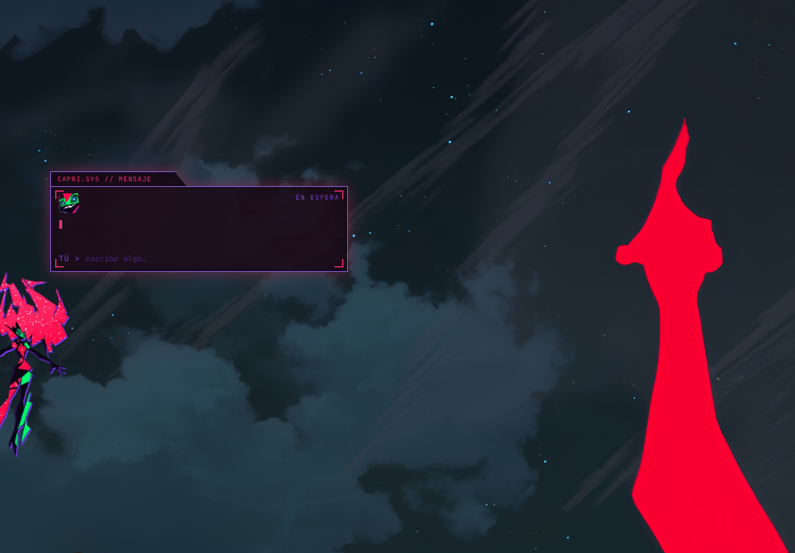
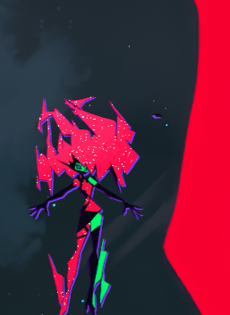
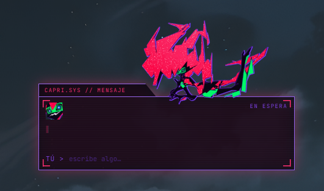
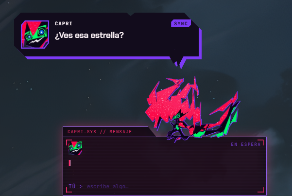
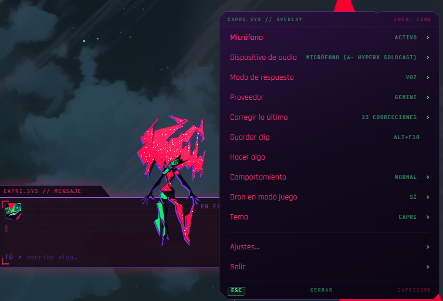
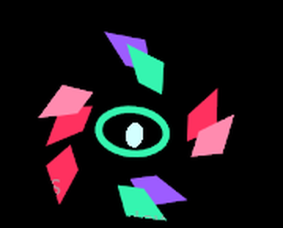
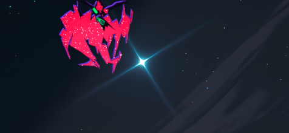

# Capri

Compañera de escritorio con el personaje **Capri** (*Cyberpunk: Edgerunners 2*): overlay siempre encima, chat, música, apps y (opcional) micrófono. Fan project basado en [mochiiwuff/capri-desktop](https://github.com/mochiiwuff/capri-desktop).

**Gratis para siempre.** No se vende. Donaciones (si las hubiera) no desbloquean nada.

## ☕ Apoyá a Capri
Capri es y siempre va a ser gratis. Si te gusta y querés ayudar a que siga creciendo:

> Fan art. **No** afiliado a CD PROJEKT RED. Licencia PolyForm Noncommercial — [LICENSE](LICENSE), [CREDITS.md](CREDITS.md).

**Versión actual:** `0.2.2` (`Capri-Setup-0.2.2.exe`).

---

## Próximamente

Lo que viene; detalle y estado en [`docs/roadmap.md`](docs/roadmap.md):

- **Copiar detalles de error** con un clic y botón **“Abrir log”**, para reportar en #bugs sin buscar archivos.
- **Wake word** que no interfiera con **audífonos Bluetooth**.
- Aviso de **SmartScreen** al instalar y **actualización con un clic**.
- Arreglo de **“Mirá mi pantalla”** cuando manda una captura vieja o el primer frame vacío.

Después: que el chat haga cosas en la PC (volumen, timers, ordenar ventanas), sentir la PC y los juegos, y voz local gratis. Detalle y prioridad en [`docs/roadmap.md`](docs/roadmap.md).

Nada de esto es de pago: las donaciones, si aparecen, no desbloquean nada.

---

## 1. Qué es

Overlay sin bordes, siempre encima. Vive en tu escritorio: puedes arrastrarla, acariciarle la cabeza, plegarla al widget `CAPRI // DORMANT`, o dejarla en forma de máscara / biochip / dron ligero.

---

## 2. Inicio rápido (sin código)

1. Baja **`Capri-Setup-0.1.2.exe`** desde [Releases](https://github.com/MtGhozt/Capri-Desktop/releases).
2. Si SmartScreen dice *Windows protegió tu PC* → **Más información** → **Ejecutar de todas formas** (el instalador no está firmado con certificado de pago; es normal).
3. Instala y abre **Capri**. No hace falta Node.js ni admin.

**Menú:** clic derecho sobre ella, o el icono de la bandeja (en Windows 11 a menudo está detrás de **^**).

La primera vez, si no hay LM Studio/Ollama local ni clave en la nube, Capri puede abrir **Ajustes → Cerebro** para que elijas cómo habla.

---

## 3. Su cerebro

**Clic derecho → Ajustes… → Cerebro.** Tarjetas: **Gratis con key**, **En mi PC** (Ollama / LM Studio), **Mi propia key** y **Usar mi agente instalado**. Pegá la key si hace falta y tocá **Probar**. Las claves quedan cifradas en tu PC (`safeStorage`; no van al repo ni a los logs).

**Compartir pantalla / memoria con la nube** está **apagado** por defecto. Personalidad y memoria: **Ajustes → Memoria → Abrir personalidad / Abrir memoria**.

---

## 4. Voz (opcional)

El instalador público **no** trae Python ni los modelos. Flujo actual:

1. Instalá **Python 3.11** ([python.org 3.11.9](https://www.python.org/downloads/release/python-3119/), marcá **Add python.exe to PATH**).
2. En Capri: **Ajustes → Oído → Instalar voz** (barra de progreso + **Ver detalles**). No hace falta PowerShell a mano.
3. **OmniVoice** solo con GPU NVIDIA. **Respuesta:** `VOZ` / `BLIPS` / `SILENCIO`.
4. Hablar: **«Hey Capri»**, **Tecla para hablar** (Ajustes → Oído; por defecto `Ctrl+Alt+V`), chat con `Ctrl+Alt+T`. Si «Hey Capri» no arranca por DLL: **Instalar VC++ x64**.

Log: `%APPDATA%\capri-desktop\logs\voice.log` — reportá en Discord **#bugs**. Detalle de desarrollo: [`docs/voz.md`](docs/voz.md).

---

## 5. Qué puede hacer (hoy)

- **Chat** en la burbuja (`TÚ > …`), personalidad cyberpunk corta.
- **Abrir / cerrar** apps, juegos y sitios que tengas en su lista **APPS** (“abre Discord”, etc.).
- **Música** (player por defecto **Namida**; **Spotify** opcional): play, pausa, siguiente, “pon \<tema\>”, “pon tu canción”, volumen / mute **solo de la música** (nunca el volumen master del PC).
- **Energía del PC** con confirmación: apagar / reiniciar / suspender.
- **No molestar:** ante pantalla completa (o apps en la lista) no se despierta sola; opciones **Silenciar en esta app** / **No silenciar nunca** / **Sacar de la lista**; puede mostrar el **dron** ligero.
- **Formas:** DORMANT, máscara dormida, biochip, teleports, poses; **agarrar y soltar**; **caricias** en la cabeza (se pueden apagar en comportamiento).
- Comentarios ocasionales, saludo al arrancar / al desbloquear (configurables).

---

## 6. Atajos

| Atajo | Qué hace |
| --- | --- |
| **Ctrl+Alt+V** | Hablar / dejar de escuchar (push-to-talk; hace falta sidecar de voz) |
| **Ctrl+Alt+Shift+Q** | Salida de emergencia (sin Sí/No; también corta el sidecar) |
| **Bandeja → Salir** dos veces (&lt; 10 s) | La 1.ª pide confirmación; la 2.ª sale sin esperar el Sí |
| Ctrl+Alt+C | Guardar / sacar (biochip) |
| Ctrl+Alt+T | Abrir chat |
| Ctrl+Alt+M (u otro libre) | Cerrar menú a la fuerza |

---

## 7. Requisitos

- **Windows 10/11, 64-bit**
- **Micrófono:** solo si quieres voz / wake word
- **Cerebro en la nube (Gemini, etc.):** basta con una clave; sirve en PCs modestas
- **LM Studio local:** más RAM/VRAM; orientativo ~Q4:

| Hardware | Ejemplos razonables |
| --- | --- |
| CPU / sin GPU | modelos ~1B–3B |
| ~4 GB VRAM | ~3B–4B |
| ~8 GB VRAM | p. ej. `google/gemma-4-e2b`, ~7–8B |
| ~12 GB+ | modelos más grandes (E4B, 12B–14B, …) |

---

## 8. ¿Es seguro? ¿Qué sale de la PC?

| Modo | Qué sale |
| --- | --- |
| **LM Studio** | El chat no va a internet: `127.0.0.1` |
| **Nube** | Solo el texto del chat (y pantalla/memoria **si** las activas) al proveedor que elegiste |
| **Claves** | Quedan en tu usuario, cifradas. No se suben al repo ni se escriben en logs |
| **Voz / mic** | Procesamiento local en el sidecar; el audio no se manda a un servicio de voz de Capri |

SmartScreen avisa porque el `.exe` **no está firmado**, no porque haya telemetría oculta.  
Código en este repo; el instalador se genera con `pnpm dist`.

**Logs:** `%APPDATA%\capri-desktop\logs\` (p. ej. `voice.log`).  
**Config:** `%APPDATA%\capri-desktop\config.json`.

---

## 9. FAQ / problemas

| Problema | Qué probar |
| --- | --- |
| **No detecta el mic** | Ajustes → Oído → Micrófono **ACTIVO**; elige dispositivo. Sin «Instalar voz» no hay lista útil. |
| **«Hey Capri» no arranca** | Ajustes → Oído → **Instalar VC++ x64**; reiniciá. Log: `voice.log` → Discord **#bugs**. |
| **Wake word flojo** | Sensibilidad de la palabra en Oído; «Pausa antes de cortar»; revisá `voice.log`. |
| **Aviso de VRAM** | LM Studio + OmniVoice pelean GPU: bajá el modelo local, usá key en la nube, o **BLIPS**. |
| **No cierra / overlay trabado** | `Ctrl+Alt+Shift+Q`, o **Salir** dos veces en la bandeja. Menú pegado: bandeja → Cerrar menú. |
| **Invisible / transparente** | Ajustes → Apariencia → Pantalla: volvé a **Automático (recomendado)** (evitar **OpenGL (experimental)** si falla). |
| **¿Habla en voz alta?** | Por defecto **BLIPS**. **VOZ** con «Instalar voz» + GPU NVIDIA (OmniVoice). |
| **¿Mac / Linux?** | Sin instalador aún (Windows x64 primero). |

---

## 10. Créditos y licencia

- Arte y código original: **mochiiwuff** — [mochiiwuff/capri-desktop](https://github.com/mochiiwuff/capri-desktop)
- Este fork: **PolyForm Noncommercial 1.0.0** — [LICENSE](LICENSE), detalle en [CREDITS.md](CREDITS.md)
- Capri es **fan art** de *Cyberpunk: Edgerunners 2*. **No** afiliado a CD PROJEKT RED / Studio Trigger.

---

# Capri (English, short)

Desktop companion overlay as **Capri** (*Cyberpunk: Edgerunners 2*), based on [mochiiwuff/capri-desktop](https://github.com/mochiiwuff/capri-desktop). **v0.1.2** — download `Capri-Setup-0.1.2.exe` from [Releases](https://github.com/MtGhozt/Capri-Desktop/releases); SmartScreen → *More info* → *Run anyway*.

**Brain:** LM Studio / Ollama locally, or free NVIDIA/Gemini keys, or OpenRouter, Groq, OpenAI, Mistral, DeepSeek in **Settings → Cerebro**. Keys stay on your PC (`safeStorage`).

**Voice (optional):** not in the public installer. Without the local `voice/` sidecar she uses **typing blips** (default) or silence. With a sidecar: wake (“Hey Capri” / “Capri”), **Ctrl+Alt+V**, Whisper STT on CPU; cloned Capri reference audio is **not** shipped — without it you get blips / Kokoro, not her clone. Mood refs live under `voice/ref/` when you set that up yourself.

**Can do:** text chat, open/close apps, music (Namida/Spotify: play/pause/next/search, music-only volume, “pon tu canción”), PC power with confirm, game-mode drone, drag/drop, head pats, dormant/sleep forms.

**Quit stuck:** **Ctrl+Alt+Shift+Q**, or tray **Salir** twice. Logs: `%APPDATA%\capri-desktop\logs\`. Fan project — not affiliated with CD PROJEKT RED. See [CREDITS.md](CREDITS.md) / [LICENSE](LICENSE).
